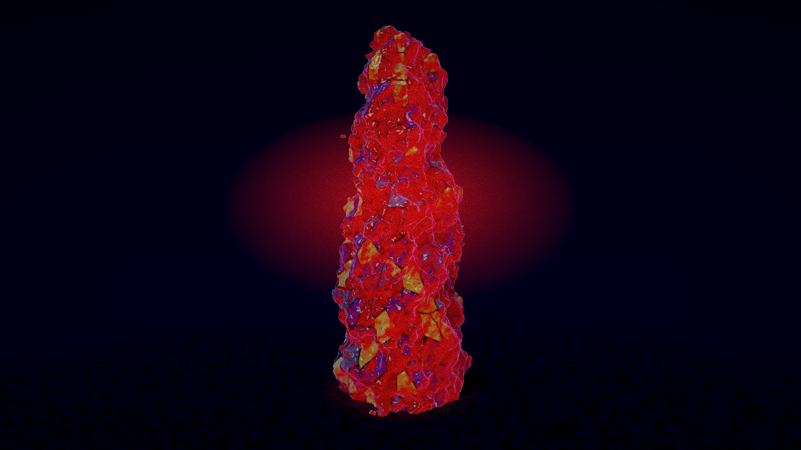
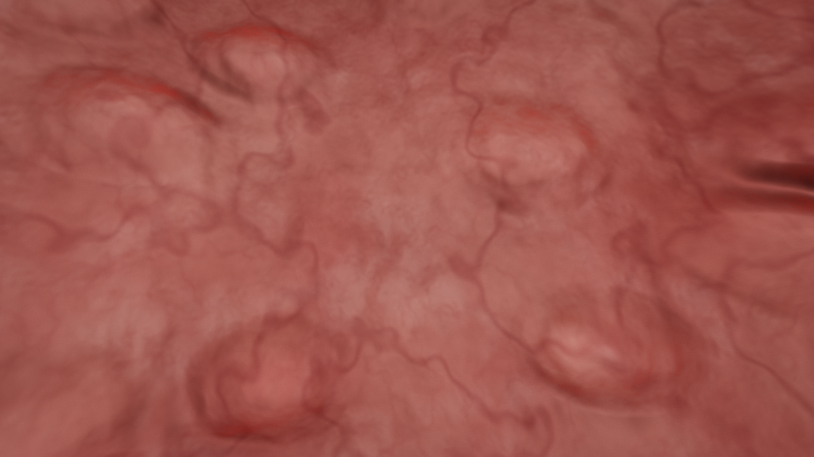
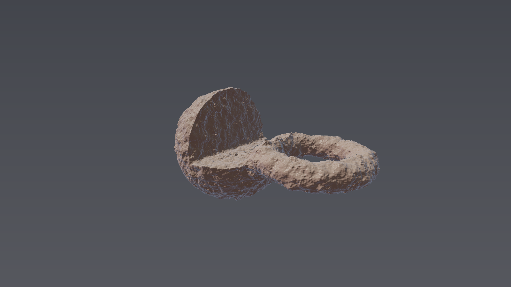
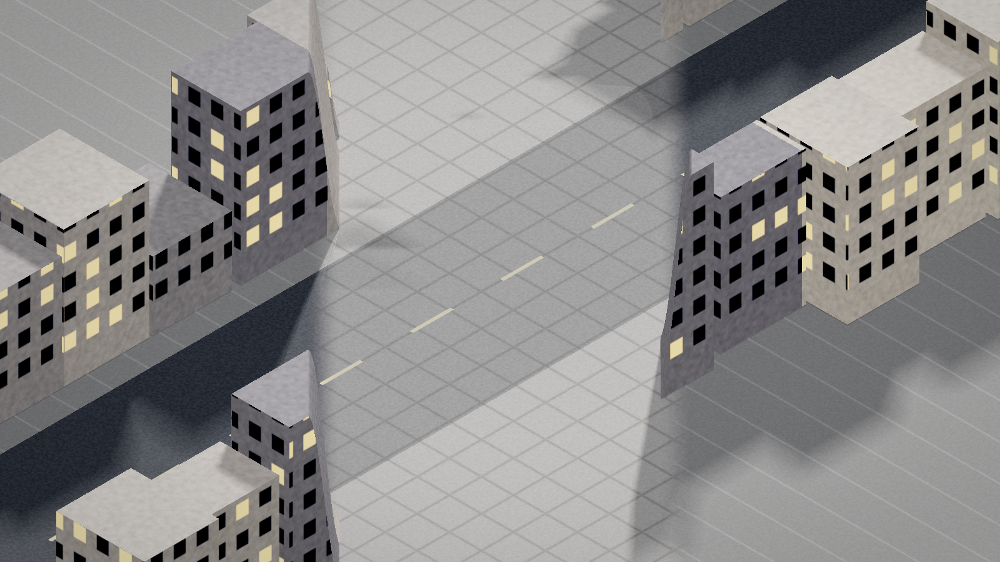
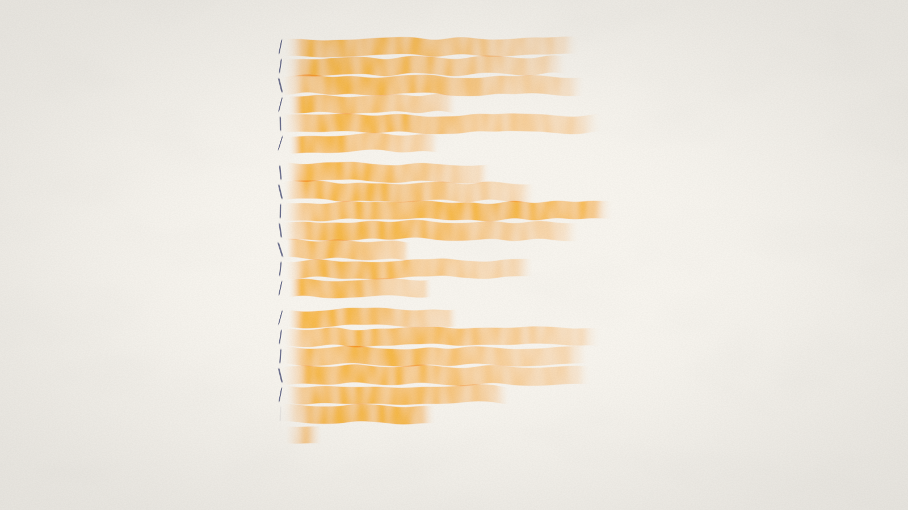
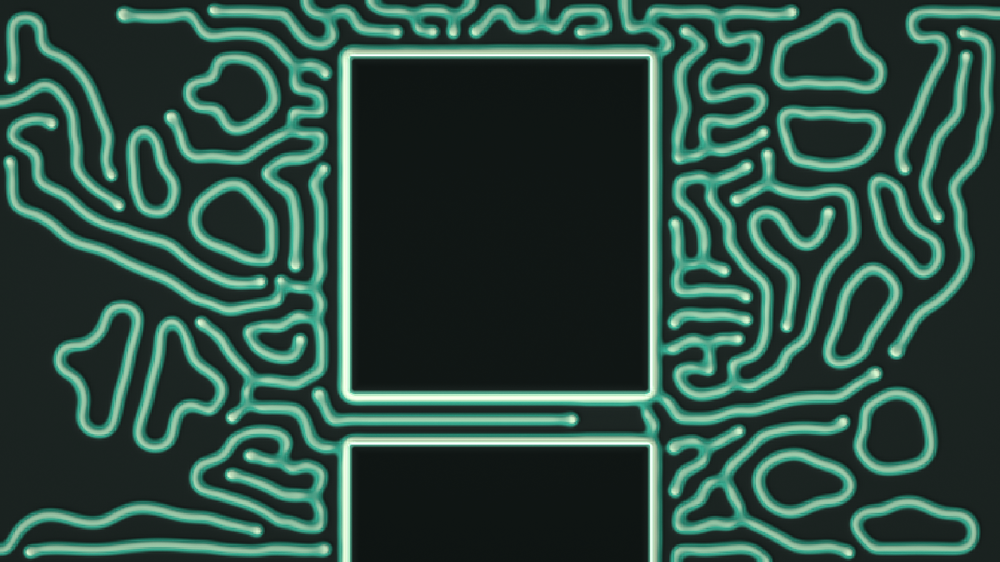

<div align="center">

# 🎨 gpu-in-html

**Reusable pure-WGSL primitives for [vgpu](https://vgpu.sh), and a gallery of WebGPU experiments where the page and the shader talk to each other.**

[](https://github.com/Markcial/gpu-in-html/actions/workflows/ci.yml)


[](LICENSE)
[](https://markcial.github.io/gpu-in-html/)

</div>

## 🖼️ Gallery

<table>
<tr><td align="center" width="33%"><a href="https://markcial.github.io/gpu-in-html/examples/01-gradient/"></a><br><sub><b>01 · Gradient</b><br><code>palette</code> · <code>polar</code> · <code>starter</code></sub></td><td align="center" width="33%"><a href="https://markcial.github.io/gpu-in-html/examples/02-cloud-form/"></a><br><sub><b>02 · Cloud form</b><br><code>sdf</code> · <code>dom-coupled</code> · <code>noise</code></sub></td><td align="center" width="33%"><a href="https://markcial.github.io/gpu-in-html/examples/03-tetsuo/"></a><br><sub><b>03 · Mutation</b><br><code>raymarch</code> · <code>sdf-3d</code> · <code>voronoi</code> · <code>subsurface</code></sub></td></tr>
<tr><td align="center" width="33%"><a href="https://markcial.github.io/gpu-in-html/examples/04-organ/"></a><br><sub><b>04 · Endoluminal intake</b><br><code>raymarch</code> · <code>interior</code> · <code>heartbeat</code> · <code>scroll-coupled</code></sub></td><td align="center" width="33%"><a href="https://markcial.github.io/gpu-in-html/examples/05-forge/"></a><br><sub><b>05 · Forge</b><br><code>typegpu</code> · <code>composition</code> · <code>raymarch</code> · <code>codegen</code></sub></td><td align="center" width="33%"><a href="https://markcial.github.io/gpu-in-html/examples/06-street/"></a><br><sub><b>06 · Street works</b><br><code>raymarch</code> · <code>dom-coupled</code> · <code>scroll-coupled</code> · <code>isometric</code></sub></td></tr>
<tr><td align="center" width="33%"><a href="https://markcial.github.io/gpu-in-html/examples/07-marginalia/"></a><br><sub><b>07 · Marginalia</b><br><code>dom-coupled</code> · <code>text</code> · <code>uniform-array</code> · <code>scroll-coupled</code></sub></td><td align="center" width="33%"><a href="https://markcial.github.io/gpu-in-html/examples/08-windtunnel/"></a><br><sub><b>08 · Wind tunnel</b><br><code>compute</code> · <code>storage</code> · <code>instancing</code> · <code>dom-coupled</code></sub></td><td align="center" width="33%"><a href="https://markcial.github.io/gpu-in-html/examples/09-culture/"></a><br><sub><b>09 · Culture</b><br><code>feedback</code> · <code>ping-pong</code> · <code>reaction-diffusion</code> · <code>dom-coupled</code></sub></td></tr>
</table>

<sub>Thumbnails are committed in <code>public/stills/</code> and rendered headless with <code>pnpm stills</code>.</sub>

## ✨ Highlights

- 🌳 **Tree-shaken at build time**: vgpu resolves the import graph, drops what an entry shader does not use, and emits compact WGSL.
- 🔗 **DOM-coupled shaders**: forms, text line boxes and `data-solid` elements are measured and handed to the GPU as uniforms.
- 🖨️ **Headless rendering through Dawn**: any frame, at any resolution, without a browser.
- ⚙️ **Compute, ping-pong and instancing examples**: 20,000 particles in `08-windtunnel`, Gray-Scott reaction-diffusion in `09-culture`.
- 🛠️ **TypeGPU at build time**: `05-forge` composes scenes as values and writes an ordinary `.wgsl` module (bundle 183 kB → 14.5 kB).

## 📁 Layout

The library is **pure WGSL**. `@gpu-in-html/wgsl` ships `.wgsl` modules and
nothing else — no TypeScript, no runtime. vgpu resolves the import graph, drops
what an entry shader does not use, and emits compact WGSL at build time.

```text
index.html           the gallery
site/gallery.ts      builds the cards from examples/manifest.json
packages/wgsl/       @gpu-in-html/wgsl — the library
examples/manifest.json  one entry per example: blurb, tags, still settings
examples/_harness/   dev-only glue shared by the examples (not published)
examples/01-*/       one runnable example per idea
public/stills/       committed thumbnails, rendered by `pnpm stills`
scripts/             shader validation, headless rendering
```

## 🚀 Run it

```bash
pnpm install
pnpm dev        # the gallery, with every example on the same server
pnpm verify     # validate every shader, typecheck, build the whole site
```

Live demos, once GitHub Pages is publishing this site:
[https://markcial.github.io/gpu-in-html/](https://markcial.github.io/gpu-in-html/).
Chrome or Edge. The production build is rooted at `/gpu-in-html/`; `pnpm preview`
serves it there.

`pnpm dev` serves the gallery at `/` and each example at
`/examples/<slug>/` — one Vite app rooted at the repository, one port, and
`vgpu` shared across the pages instead of bundled once per example. Each
example is still its own workspace package resolving `@gpu-in-html/wgsl` by
package name, which is what keeps the library honestly consumable.

To add an example: create `examples/<slug>/` with an `index.html` and a `src/`,
then add an entry to `examples/manifest.json`. Vite picks up the page, the
gallery grows a card, and `pnpm stills` renders its thumbnail.

WebGPU is required. If `init()` throws, the example prints the error on the
page instead of leaving a black canvas.

## 🖨️ Render headless

The same entry shader renders without a browser, through Dawn:

```bash
pnpm render examples/01-gradient/src/gradient.wgsl -o out/01.png -w 3840 -h 2160 -t 2.5
pnpm stills   # re-render every gallery thumbnail from examples/manifest.json
```

`-t` is the `time` uniform in seconds, so any frame of an animation can be
pulled as a still at any resolution. Run `npx vgpu doctor` first on a new
machine — it acquires an adapter and renders a real frame, and prints the exact
fix as JSON when something is missing.

This is also the hook for snapshot tests: render a fixed `-t` and compare
against a committed PNG. Not wired into CI yet — the GitHub runner needs
`npx vgpu install-software-renderer` for deterministic output, which has not
been verified here.

## 🧩 Using the primitives

Import them by package path from any entry shader:

```wgsl
import { centered, polar } from "@gpu-in-html/wgsl/space";
import { paletteDefault } from "@gpu-in-html/wgsl/color";
import { linearToSrgb3, tonemapAces } from "@vgpu/wgsl-std/color";

struct Params {
  resolution: vec2f,
  time: f32,
}

@group(0) @binding(0) var<uniform> params: Params;

@fragment
fn fs_main(@location(0) uv: vec2f) -> @location(0) vec4f {
  let p = centered(uv, params.resolution);
  return vec4f(linearToSrgb3(tonemapAces(paletteDefault(polar(p).y))), 1.0);
}
```

| module | what's in it |
| --- | --- |
| `@gpu-in-html/wgsl/space` | `centered`, `flipY`, `rot2`, `rotate`, `polar`, `tile`, `kaleidoscope` |
| `@gpu-in-html/wgsl/shaping` | `remap`, `aastep`, `sdFill`, `sdStroke`, `pulse`, `easeInOutCubic` |
| `@gpu-in-html/wgsl/sdf` | `opUnion` / `opSubtract` / `opIntersect` in hard and smooth forms, plus `opRound` and `opOnion`. Operate on distances, so they are shared by 2D and 3D |
| `@gpu-in-html/wgsl/shape2d` | `sdCircle`, `sdBox`, `sdRoundedBox`, `sdSegment`, `sdStar` |
| `@gpu-in-html/wgsl/shape3d` | `sdSphere`, `sdBox`, `sdRoundBox`, `sdTorus`, `sdCapsule`, `sdPlane`, `sdEllipsoid`, `opRepeat`, `opMirror`, `opTwist`, `rotX`, `rotY` |
| `@gpu-in-html/wgsl/camera` | `Ray`, `rayFromUv`, `lookAt`, `orbit` |
| `@gpu-in-html/wgsl/voronoi` | `voronoiTiled`, `cellRandom` — a Voronoi whose x axis wraps, for cylindrical projections |
| `@gpu-in-html/wgsl/color` | `palette`, `paletteDefault`, Oklab/Oklch, `mixOklab` |
| `@gpu-in-html/wgsl/post` | `vignette`, `grain`, `applyGrain`, `contrast`, `halation`, `fog` |

This package only holds what `@vgpu/wgsl-std` does not. Take hashing and noise
from `@vgpu/wgsl-std` (`hash`, `noise`, `noise/perlin`, `noise/simplex`),
transfer functions and tonemapping from `@vgpu/wgsl-std/color`
(`srgbToLinear3`, `linearToSrgb3`, `tonemapAces`), and scalar helpers from
`@vgpu/wgsl-std/math`. Check there before adding anything here.

## 🧪 Examples

| | |
| --- | --- |
| [`01-gradient`](https://markcial.github.io/gpu-in-html/examples/01-gradient/) | A fullscreen fragment shader and nothing else — the smallest thing that renders. |
| [`02-cloud-form`](https://markcial.github.io/gpu-in-html/examples/02-cloud-form/) | A real HTML `<form>` with no background of its own, over a canvas that draws the cloud serving as its chrome. A `ResizeObserver` feeds the form's measured rect to the shader, so the silhouette tracks the DOM through any reflow, and `focusin`/`focusout` swell the cloud. |
| [`03-tetsuo`](https://markcial.github.io/gpu-in-html/examples/03-tetsuo/) | A raymarched arm coming apart. Masses erupt along the limb through smooth unions, and a cylindrically projected Voronoi separates the surface into cells of muscle, bruise, fat and something colder. A `<input type="range">` drives the mutation and the telemetry panel reads from the same number. |
| [`04-organ`](https://markcial.github.io/gpu-in-html/examples/04-organ/) | The same cylinder turned inside out and faced rather than travelled down, with a long HTML form over it. Lamp on the lens, nodules fixed on Voronoi seed points, and a heartbeat that moves the whole wall as one body and flushes it redder on systole. Scrolling the form moves the camera along the wall; the tone field writes straight into the shader. |
| [`05-forge`](https://markcial.github.io/gpu-in-html/examples/05-forge/) | Scenes composed as values: combinators take distance functions and return new ones, so a scene reads `displace(smoothUnion(subtract(sphere, box), at(torus)))` and each emits a real WGSL function with its operands inlined. TypeGPU does that at build time and writes an ordinary vgpu module, so the browser never loads it and the resolver, tree-shaking, validation and the thumbnail all work as if the file were handwritten. |
| [`06-street`](https://markcial.github.io/gpu-in-html/examples/06-street/) | An isometric block that gets out of the form's way. The camera is orthographic, which is the point: world-to-screen is then a fixed linear map, so the shader can project any sample point and ask whether it lands inside the form's measured rect. Where it does, nothing is allowed to stand: the buildings cut back from the edge and the street widens into a paved plaza under the page. Their windows are shaded on from the hit position and the face normal rather than modelled, so a facade full of them costs the same as a bare wall. The clearing tracks only the visible slice of the three-page form; the whole rect would delete the city rather than make room in it. |
| [`07-marginalia`](https://markcial.github.io/gpu-in-html/examples/07-marginalia/) | A page that highlights itself, line by line. Every other DOM-coupled example here hands the shader one rectangle; this one hands it up to forty-eight, because `Range.getClientRects()` returns one rectangle per *line box* — the browser reporting where its own line breaking landed. That is the point: line breaking depends on the font file, the hyphenation dictionary and the reader's zoom, so a shader can never do it. The ragged right edge of the marks is not noise, it is where each line of text actually stops. Strokes are seeded per line so nothing crawls, the ink multiplies the paper rather than covering it, and a mark draws itself left to right as its line passes the sweep. |
| [`08-windtunnel`](https://markcial.github.io/gpu-in-html/examples/08-windtunnel/) | Twenty thousand particles of air blown across a page that is in the way. Every element marked `data-solid` is measured each frame and handed to a compute shader as a rounded box; the air is deflected twice by each one — the velocity component heading into the surface is removed, which is what makes flow slide along an edge instead of stopping dead at it, and a push down the outward normal keeps particles out of the interior. Focus or hover a control and its rectangle swells, widening the wake behind it. The particles never travel back through the host: seeded once into a storage buffer, advanced by a compute dispatch, and drawn as instanced quads whose corners come from `@builtin(vertex_index)` and whose particle comes from `@builtin(instance_index)` — no vertex buffer, no geometry, no readback. The thumbnail is the background pass alone, which is the part a fullscreen still can render. |
| [`09-culture`](https://markcial.github.io/gpu-in-html/examples/09-culture/) | A Gray-Scott reaction growing on the page, and the first shader here that can see what it drew last time. Two `rgba16float` targets are swapped each step: the reaction samples one and renders into the other, sixteen times per displayed frame. The precision is not incidental — a step moves a concentration by less than one level of an eight-bit channel, so in `rgba8unorm` the whole system quantises to a standstill. The page enters twice: every rectangle marked `data-solid` is inert, so the culture grows right up to the text and stops, and the distance to the nearest rectangle picks the feed and kill rates — coral close in, worms further out. A few thousandths is the whole difference between the two, and the layout is what chooses. |

Colours in a shader are authored in sRGB and converted with `srgbToLinear3`
before use. Using picker values as if they were linear makes a mid blue roughly
four times too bright, and everything washes out. The same conversion bites the
other way in dark scenes: sRGB `0.06` is linear `0.004`, which a vignette and a
contrast curve will finish off entirely. A dim-but-readable room wants to be
authored around sRGB `0.2`, not `0.05`.

## 🔗 Coupling the page to the shader

Two examples do it, and both do the same thing: read something the browser
already knows and hand it to the shader as a uniform.

`02-cloud-form` measures the form's bounding rect with a `ResizeObserver` and
passes it in uv space, so the cloud's silhouette is the form's own rectangle.
`04-organ` does the same and more: it passes the form's rectangle *and* the
scroll position, so the wall is drawn differently exactly where the form
presses on it and scrolling moves the camera along the wall rather than moving
the document over a static backdrop. Its tone field is an ordinary
`<input type="range">` that happens to write into a uniform.

The technique there is worth calling out. A form needs a readable ground, and
the obvious answer — a translucent panel — is precisely what makes it read as a
layer floating over the render. Instead, ask what the material would really do
under something pressing on it, and have the shader do that. Tissue under
pressure congests: the rim pinches pale where the blood is actually driven out,
and inside it pools and darkens toward venous red. That gives the type its
ground *and* explains itself — relief still shows through, the vessels engorge
rather than vanish, and the patch still throbs on the beat.

Which direction to take it is a typography decision, not a physiological one.
Congestion darkens, which suits white type; blanching lightens, which suits
dark type. Both are real; pick the one that matches the palette.

Then take the opacity most of the way back off. Mixed near opaque, the treated
region becomes its own flat surface and the form is sitting on a panel again —
just one drawn by the shader instead of by CSS. Held around 0.6, the mucosa's
variation, its nodules and its vessels stay legible straight through the region
the type sits on, and *that* is what reads as integrated. The same applies to
the CSS: pull the accent off full saturation, the text off pure white, and the
field fills down to a few percent. Anything that stays crisp and pure against
tissue reads as chrome dropped on top of it.

### 🥪 The DOM can be sandwiched between two canvases

A canvas is not restricted to sitting behind the page. Give a second one a
`z-index` above the content and `pointer-events: none`, create its surface with
`alphaMode: "premultiplied"`, and clear it to `[0, 0, 0, 0]`, and it composites
over the DOM while leaving it fully interactive. Both surfaces can be created
from one `Gpu` and drawn in a single `frame`.

```ts
const back = surface(gpu, backCanvas);
const front = surface(gpu, frontCanvas, {
  alphaMode: "premultiplied",
  clearColor: [0, 0, 0, 0], // without this the overlay paints opaque black
});
frame(gpu, (f) => {
  f.pass(back, wall);
  f.pass(front, foreground);
});
```

Verified with a probe: stripes drawn on the front surface cross over a heading,
an input and a paragraph, and the input still takes focus and typing. So a
vessel can pass *in front of* a form rather than only behind it, and the page
sits inside the scene rather than on top of it. The shader writes premultiplied
colour — `rgb` already scaled by `a`.

What this still does not give is glyphs that deform with the surface. Text is
composited by the browser, so it stays flat and crisp no matter what is drawn
over it. Deforming the type itself means rasterising the DOM into a texture,
and that costs selection, focus and accessibility.

Three things to get right:

- **Measure the panel rect every frame, and do not ease it.** It has to sit
  exactly where the browser drew the form; easing lets the tissue slide out
  from under the text mid-scroll. Ease the *camera* instead, and the small lag
  reads as parallax.
- **Guard against a zero-size rect.** A rounded box of zero extent is still a
  disc of its corner radius, so a page with no form — or a headless render —
  gets a stray blanched dot in the middle of frame.

- **Ease every input, framed in `deltaTime`.** Scroll events from a wheel or a
  trackpad arrive in coarse jumps, and following them literally makes the
  camera stutter. `x += (target - x) * (1 - exp(-dt * k))` behaves the same at
  60 and 120 Hz.
- **Register scroll listeners as `{ passive: true }`.** They never call
  `preventDefault`, and saying so lets the browser keep scrolling on the
  compositor instead of waiting on the handler.

## 🔦 Raymarching

There is no `march()` or `normalAt()` in this package, and there cannot be:
both have to call *your* scene function, and WGSL has neither function pointers
nor generics. The march loop belongs in the entry shader. Everything around it
that does not depend on the scene — shapes, domain and combination operators,
camera rays, the grade — is here. `examples/03-tetsuo/src/scene.wgsl` is the
reference for how the two fit together.

Displacing an SDF with noise breaks the Lipschitz bound the marcher relies on,
so a full-length step will tunnel through thin features. Scaling the returned
distance down (`return d * 0.55`) is the standard fix.

### 🧪 TypeGPU could lift that restriction — spike notes

Spiked against typegpu 0.12.4 and vgpu 0.3.1. What was verified, by running it:

- `tgpu.resolve([fn])` emits plain, readable WGSL, and vgpu's `effect()`
  compiles and renders it. TypeGPU as an authoring layer over vgpu as the
  runtime composes fine.
- **The generic marcher is achievable.** A `makeMarcher(sdf)` factory produced
  two marchers specialised on different SDFs — `marchSphere` calling
  `sdSphere`, `marchTorus` calling `sdTorus` — by binding a name in the body
  through `.$uses({ sceneSdf: sdf })`. WGSL still has no function pointers;
  the specialisation happens at generation time, one variant per scene. That
  is exactly the restriction above, lifted.
- WGSL-string bodies need no build plugin, so the Node scripts keep working.
- Unknown identifiers in a string body pass straight through resolution, so
  external WGSL can be concatenated around the output.

What it would cost:

- **`typegpu/std` is the WGSL builtins, not a shader library.** All 166 exports
  are language functions — `abs`, `mix`, `textureSample`, subgroup ops. No
  noise, no hash, no simplex. This package leans on `@vgpu/wgsl-std` for
  precisely those.
- `$uses` rejects raw WGSL strings, so existing WGSL cannot simply be dropped
  in as an external.
- Bridging to `@vgpu/wgsl-std` works but needs glue: vgpu's resolver
  tree-shakes anything unreferenced and mangles every name to
  `_vgsl_<hash>__<original>`, so you resolve a bridge entry, then rewrite the
  call sites in the TypeGPU output. Mechanical, but glue.
- **`pnpm check` stops applying.** The CI gate validates `.wgsl` files;
  generated shaders would need a script that resolves first, then validates.

And one thing the spike did *not* establish. The types-instead-of-documentation
argument only pays off with TGSL — shader bodies written as `'use gpu'`
TypeScript functions — and that path needs the build plugin, which was not
tested here. With string bodies the types stop at the signature: the body is
still an unchecked WGSL string.

`05-forge` is the trial, and it settled the question: **the two are cleanly
interoperable, as long as TypeGPU runs at build time.**

The first pass composed the scene in the browser and handed the resolved string
to `effect()`. That works, and it is horrible. Getting wgsl-std into the module
took four failures: `$uses` refuses raw WGSL; vgpu's resolver tree-shakes
anything no entry point reaches, so the bridge needs a keeper entry point;
that keeper leaves a second `@fragment` and vgpu picked *it*, so the first
"working" build rendered the raw noise field; and stripping just the attribute
breaks compilation, because `@location` on a parameter is only legal on an
entry point. The keeper has to be excised whole by regex. On top of that,
`pnpm check` and `pnpm stills` both stop applying to a shader that does not
exist until runtime.

Moving generation to build time deletes every one of those problems at once.
`scripts/forge-gen.ts` composes the scene, `emitModule` resolves it and marks
the public functions `export`, and the result is written as
`scene.generated.wgsl` — an ordinary vgpu module. From there nothing is
special:

- the wgsl-std import is a plain `import` in the generated file, resolved
  natively — no bridge, no name rewriting, no keeper;
- `pnpm check` validates the generated module like any other;
- `pnpm stills` renders a thumbnail, because there is an entry file again;
- tree-shaking and the module graph work as designed;
- and TypeGPU leaves the browser entirely. The example's bundle went from
  183 kB to 14.5 kB when generation moved out of it.

The division of labour that falls out of this is the one worth keeping.
**vgpu owns the runtime and the tooling** — the module graph, validation,
headless rendering, the agent-facing CLI and docs. **TypeGPU owns authoring** —
composition, and types across the JS boundary. They meet at a `.wgsl` file,
which is a boundary both were designed to speak.

Still untested: TGSL, where shader bodies are `'use gpu'` TypeScript rather
than WGSL strings. That is where the types-instead-of-documentation argument
would actually pay off, and it needs the build plugin.

### ✅ Decided: split by domain, not by layer

Rendering stays with vgpu. Compute, if and when this repository grows any, goes
to TypeGPU — that is what it is for, and its typed buffers infer TypeScript
types from the GPU-side layout, which is most of the pleasure of writing
compute at all.

They do not have to meet. Rendering already gets everything it wants from
TypeGPU at build time, through a generated `.wgsl` file, with nothing left at
runtime.

If a compute pass ever does need to feed the renderer, the precondition is that
both sit on the same `GPUDevice` — buffers cannot cross devices. Both libraries
support that through public API:

```ts
const device = await (await navigator.gpu.requestAdapter()).requestDevice();
const gpu = await initFromDevice(device);          // vgpu
const root = tgpu.initFromDevice({ device });      // typegpu
```

The handoff itself is the part to be careful with. TypeGPU's `root.unwrap()`
gives the raw `GPUBuffer`, but vgpu's function for adopting a foreign buffer is
marked `@internal`, so the supported route is a buffer-to-buffer copy on the
shared device rather than aliasing. One copy per frame, which for a compute
result is nothing.

The reason to keep them apart until then: the moment both libraries own buffers
in the same program, there are two answers to "who allocated this", and that is
exactly the kind of seam the build-time split just removed.

Two shading notes worth keeping, both learned the hard way in `03-tetsuo`:

- **Texture a cylinder with `voronoiTiled`, not `voronoi2d`.** The angular
  coordinate wraps, and a Voronoi keyed on `floor(position)` puts different
  cells on the two sides of the join, so the seam runs visibly down the shape.
- **Backscatter belongs on the side facing away from the light.** Measuring
  material between the point and the light and glowing where there is little
  fires hardest exactly where the surface already faces the light — nothing is
  in the way, so the term saturates and washes every other colour out.
  Weight it by `1 - diffuse`.

Interiors invert the whole setup, and `04-organ` is the reference. The field is
positive in the open space and negative in the tissue, so marching it from
inside is the only change the geometry needs. The lighting is what actually
sells it: put the lamp on the camera, and the light direction, the view
direction and the specular half-vector all collapse to the same vector while
distance falloff makes the tunnel ahead go black with no backdrop drawn at all.
Two numbers need taming — true inverse-square leaves a lit ring at the frame
edge and nothing else, and the void should be a deep red rather than black or
it reads as a missing object instead of depth.

Three more things separate organic from moulded, and none of them is detail:

- **Vary colour continuously, not in cells.** A Voronoi is right for the arm,
  where the tissue really is coming apart in patches. At mucosal scale the same
  field reads as camouflage. Two low frequencies of noise inside a narrow hue
  range is what a real membrane looks like.
- **Wet does not mean glossy.** Mucus pools; it does not coat evenly. A weak
  specular masked by a noise field reads wet, while an even sheen over the
  whole wall reads as moulded plastic.
- **Wrap the diffuse.** Light does not stop at the terminator in translucent
  tissue. `saturate((n·l + w) / (1 + w))` with `w` around `0.4` softens it.

Motion follows the same rule. A body is never still and never busy: slow
peristalsis, a slight breath, and a drift rather than a flythrough.

Two framing notes, both of which cost a rewrite to learn:

- **Facing a wall and travelling down a tube are different shots**, even with
  identical geometry. Pointing the camera outward from just off the axis fills
  the frame with surface; pointing it along the axis makes a tunnel. Only the
  camera changes.
- **Move the camera, not the look-at target.** Nudging a target several units
  away by a fraction of a unit is an angular change small enough to look like
  the input is dead. Mapping the pointer onto the camera's own position —
  here, its angle around the axis and its height — is what makes it feel
  connected.

Lamp gain is tied to how far the subject is. The value that lit a receding
tunnel blows out a wall at arm's length; expect to retune it whenever the
framing changes.

Three more things separate tissue from a mirror, in the order they mattered:

- **Perturb the normal with fine noise.** A smooth normal plus any specular at
  all reads as polished, whatever the colour underneath. Two scales of noise
  gradient tilted into the normal cost four samples on hit pixels only —
  putting the same detail in the SDF would cost an evaluation on every step of
  every ray and force shorter steps as well.
- **Texture in a space attached to the surface, not in world space.** The wall
  moves, so sampling at the world-space hit point makes the whole pattern swim
  across the tissue. Projecting back onto an undeformed cylinder throws away
  exactly the component that moves.
- **Do not scroll the surface noise.** A body's shape moves; its texture does
  not travel through it. Scrolling noise makes the surface boil, and against
  high-frequency shading that boiling is most of what reads as restlessness
  even when every rate is already slow.

Placing features and moving them are separate problems, and both have a right
answer here:

- **Scatter with a Voronoi, not with noise.** fbm clumps: it gives lumpy
  regions with bare patches between them. A Voronoi's feature points are close
  to evenly spaced, so domes placed on them cover a surface the way nodules on
  a real membrane do.
- **For anything that branches, build the topology; do not fake it with a
  level set.** `1 - smoothstep(0, w, abs(noise))` is the usual trick for
  vessels, cracks and lightning, and it is wrong for all of them in the same
  way: the zero set of a scalar field is a collection of *closed contours*, so
  the branches loop back on themselves and their ends stop dead. A tree of
  tapered capsules has no cycles by construction, and a tip whose radius
  reaches zero thins away instead of being cut off. Scatter the trees on a
  wrapped lattice and evaluate the neighbouring cells so coverage carries
  across.
- **Bend it with a domain warp, not by curving the segments.** Straight
  segments read as arrows. Warping the sample point bends every branch at once,
  and because a warp is a homeomorphism it cannot introduce a loop or break
  one — the topology survives it intact. Derive the warp from a coordinate that
  is periodic around the shape, or it tears the seam.
- **Fade the dome out before the cell border.** `f1` is continuous but its
  gradient is not — it kinks wherever the nearest feature changes — so
  displacing a surface by it creases along every border and those creases
  render as hard straight lines. `f2 - f1` goes to zero exactly there, so
  multiplying by `smoothstep(0, w, f2 - f1)` flattens the displacement wherever
  the kink is.
- **A pulse is not a wave.** Anything with a spatial phase slides features
  through frame, which reads as peristalsis. For tissue that is simply alive,
  move the entire surface together and shape the motion in time instead: a
  strong pulse, a weaker one after it, then a pause. A plain sine reads as
  breathing; the asymmetry and the gap are what make it a beat.
- **Drive the colour from the same waveform.** Blood floods the tissue on
  systole, so the wall should flush, and it flushes by *desaturating less* —
  red holds while green and blue drop — not by getting brighter. Measured
  across a beat: red 161.8 → 162.6 while green falls 42.7 → 33.9 and blue
  32.0 → 25.6. Raising luminance instead would read as a light flickering.
- **Leave chroma headroom.** Pushed to full saturation, green and blue sit at
  zero and shading can only move the red channel, which clips almost at once
  and flattens the relief away. A vivid red that still shows its form needs to
  stop short of the edge of the gamut.

**Measure motion, do not judge it by eye.** Render the same shader at two
timestamps and compare pixels, then render two timestamps a frame apart to
establish the grain floor and subtract it. Tuning 04-organ this way found that
the surface noise scroll, not the peristalsis rate, was the main offender —
and took the motion above the grain floor from 4.9 points to 1.2 over three
seconds while leaving it visibly alive.

## 📏 Authoring rules

Three rules, and the first is enforced by vgpu itself:

1. **No `@group`/`@binding` in a module.** Imported modules are pure; declaring
   a resource fails resolution with `VGPU-RESOLVE-MODULE-BINDING`. Export the
   data shape as a `struct` and take it as a parameter. The entry shader owns
   its bindings.
2. **No implicit `time` or `resolution`.** Anything a function depends on
   arrives as an argument, so the same function works in an animation, a
   headless still, and a test.
3. **One concern per file, explicit names.** `sdBox`, not `box`. Every export
   gets a comment saying what it is for, and at least one example uses it.

`uv` is top-origin: `(0,0)` is the top-left and `v` grows downward, matching
WebGPU texture coordinates. Porting a y-up shader? Call `flipY` once at the
boundary and stay flip-free after that.

## ➕ Adding a primitive

1. Write it in the right module under `packages/wgsl/src/`, or add a new module
   and register it in that package's `exports` map.
2. Use it from an example. A primitive with no caller is not verified.
3. `pnpm verify`.

## 📄 License

[MIT](LICENSE) © 2026 Marc Garcia.

---

<div align="center">

Made by **Marc Garcia** · [marcgarcia.dev](https://marcgarcia.dev) · [@_marc_garcia on X](https://x.com/_marc_garcia) · [GitHub](https://github.com/Markcial)

</div>
